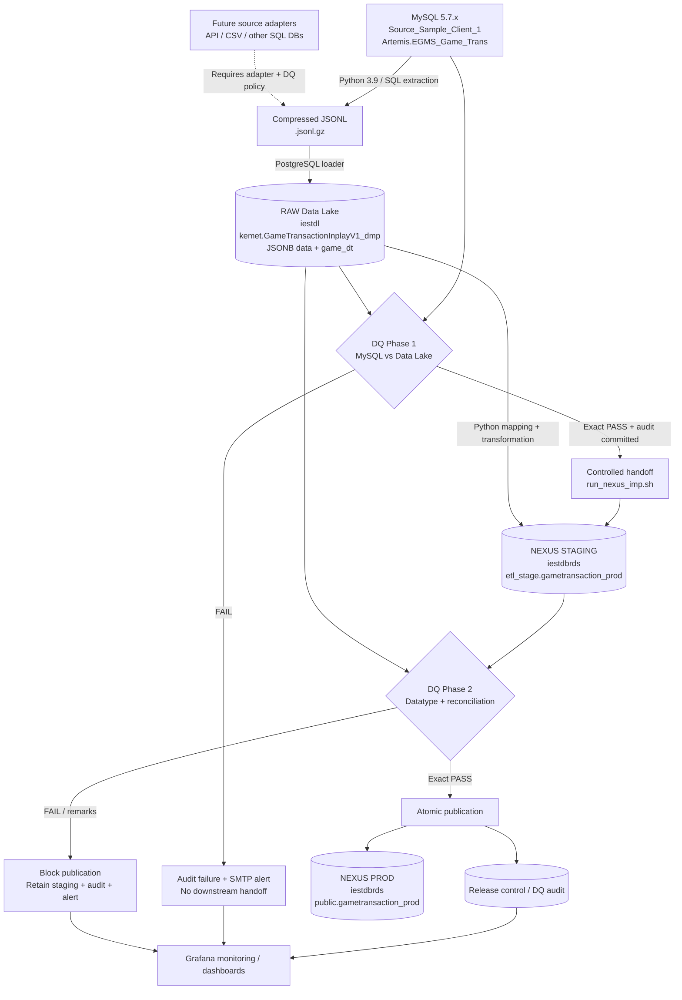

# PRISM

**Pipeline for Relational Ingestion and Storage Modernisation**

> A controlled, auditable ETL pipeline that ingests source data into a JSON-based raw data lake, validates it against the source, then transforms and publishes approved records into structured PostgreSQL reporting tables.

## Introduction

PRISM is a modular data-ingestion, transformation and quality-control project. Its core idea is simple: **receive source records in a flexible raw JSON format, preserve the source evidence, and convert those records into clean, typed, relational tables ready for applications, analysis and reporting.**

The current reference implementation migrates game transactions from a **MySQL 5.7.x source** (`Source_Sample_Client_1`, represented in the implementation by `Artemis.EGMS_Game_Trans`) through a **PostgreSQL JSONB Data Lake** into a **PostgreSQL NEXUS production table**. Python 3.9 orchestrates extraction, loading, transformation, calculated fields, two independent data-quality (DQ) stages, audit reporting and alerts.

**Can PRISM work with other data sources?** Yes, by design. A source adapter can retrieve data with a database SQL query, API request, file import or Python connector, then normalize its output into an agreed raw-data contract. An additional source is **not automatically compatible**: it needs its own authentication, incremental extraction/watermark, field mapping, key strategy, timezone convention, transformations and source-to-target DQ policy. The implemented and verified path in this README is **MySQL → PostgreSQL Data Lake → PostgreSQL NEXUS**, not an assertion that every connector has already been built.

## Workflow at a glance

1. **Extract** the selected MySQL business window into compressed JSON Lines (`.jsonl.gz`).
2. **Load raw data** to the Data Lake's PostgreSQL JSONB table, preserving source transaction IDs and timestamps under the existing timestamp contract.
3. **DQ Phase 1 — MySQL → Data Lake:** compare source records with their raw Data Lake representations; persist an auditable `PASS` or `FAIL` result.
4. **Handoff on approved PASS:** trigger the Data Lake → NEXUS pipeline with the **same original business-window dates**.
5. **Stage and transform:** map JSON fields into typed PostgreSQL NEXUS staging columns, compute approved derived amounts and preserve transformation rules.
6. **DQ Phase 2 — Data Lake → NEXUS:** check datatype compatibility and reconcile the staged transaction population, fields and financial amounts.
7. **Release only on exact PASS:** atomically publish validated records into NEXUS production, write release status, and clean only the approved staging window **if transactional cleanup has been deployed and verified**.
8. **Monitor and recover:** retain DQ evidence and use SMTP alerts, release-control records, logs and Grafana dashboards for observability.

## High-level architecture



> **Deployment status:** Grafana is an intended monitoring integration. Dashboard provisioning, metrics exporters and alert rules must be separately configured; the ETL audit tables do not automatically create a Grafana dashboard.

## Technology stack

| Layer | Current technology | Purpose |
|---|---|---|
| Source | MySQL 5.7.x | Original relational transaction data; version to be verified on each deployment |
| Extraction and orchestration | Python **3.9**, Bash, SQL, Python virtual environment | Window-driven extract, transform, validation, invocation and logging |
| Intermediate files | Compressed JSON Lines (`.jsonl.gz`) | Replayable batch input; extraction artifact |
| Raw / Data Lake | PostgreSQL (`iestdl`), `JSONB` | Flexible landing format, source evidence and indexed transaction/window keys |
| Staging | PostgreSQL (`iestdbrds.etl_stage`) | Typed candidate rows isolated from production until approved |
| Production / NEXUS | PostgreSQL (`iestdbrds.public`) | Authoritative structured reporting destination for the migrated data |
| Hosting | AWS RDS PostgreSQL | Managed PostgreSQL deployment; availability, backup, TLS and access controls require configuration |
| Quality and audit | Python, SQL, PostgreSQL `db_admin` tables | Two DQ gates, run evidence, error classification and release approval |
| Alerts | SMTP using `shared_functions/etl_alert.py` | Delivery of failure notifications and operational signals |
| Visualization | Grafana (planned/integrated as configured) | ETL progress, row counts, DQ status, lag, durations and exceptions |

### Example repository layout

```text
~/scripts/nexus_etl_prod/
├── art_mysql-dlake_psql/
│   ├── batch_daily_extract.sh
│   ├── egms_gametx_inplayv1_mysql_extractor.py
│   ├── batch_daily_loader.sh
│   ├── egms_gametx_inplayv1_pg_loader.py
│   ├── egms_gametx_dq.py
│   └── daily_dump/jsonl/YYYYMM/*.jsonl.gz
├── dlake_psql-nexus_psql/
│   ├── run_nexus_imp.sh
│   └── helpers/
│       ├── strict_pipeline.py
│       ├── dq_datatype.py
│       ├── dq_reconcile.py
│       └── strict_publish.py
└── shared_functions/
    └── etl_alert.py
```

The current handoff is `egms_gametx_dq.py` → `../dlake_psql-nexus_psql/run_nexus_imp.sh <from-date> <to-date> gameTransaction`. The downstream script must continue reconstructing the same 06:00-to-06:00 business window.

## Data model and field mapping

### Source to raw Data Lake

| MySQL source: `Artemis.EGMS_Game_Trans` | Raw JSON key | PostgreSQL landing representation | Notes |
|---|---|---|---|
| `TransactionID` | `TransactionID` | `kemet."GameTransactionInplayV1_dmp".id` and `data->>'TransactionID'` | Transaction identity; must agree |
| `GameDate` (`DATETIME`) | `GameDate` | `game_dt` (`TIMESTAMPTZ`) and `data->>'GameDate'` | Uses the current **UTC-assumed wall-clock** contract |
| `TotalStakes` | `TotalStakes` | `data` JSONB | Exact decimal serialized as JSON string in observed data |
| `TotalWins` | `TotalWins` | `data` JSONB | Exact decimal serialized as JSON string in observed data |
| `PC1`–`PC5` | `PC1`–`PC5` | `data` JSONB | Jackpot contribution components |
| `JW1`–`JW5` | `JW1`–`JW5` | `data` JSONB | Jackpot payout components |
| Calculated `SUM(PC1..PC5)` | `JACKPOT_CONTRIBUTION` | `data` JSONB | Derived during ingestion; DQ recomputes |
| Calculated `SUM(JW1..JW5)` | `JACKPOT_PAYOUT` | `data` JSONB | Derived during ingestion; DQ recomputes |

### Data Lake JSONB to NEXUS staging and production

The NEXUS transformation writes typed rows to `etl_stage.gametransaction_prod` and, only after DQ approval, to `public.gametransaction_prod`.

| Data Lake JSON key / rule | NEXUS column | Destination type | Validation |
|---|---|---|---|
| `TransactionID` | `externalid` | `TEXT` | Required; identity must match expected source key |
| `GameDate` | `startdatetime`, `enddatetime` | `TIMESTAMPTZ` | Preserve approved UTC-assumed wall-clock representation; verify actual mapping of end time |
| `GameProvider` | `providername` | `TEXT` | Text compatibility / transformation mapping |
| `GameName` | `gamename` | `TEXT` | Text compatibility / transformation mapping |
| `PlayerAccount` | `playerusername` | `TEXT NOT NULL` | Must satisfy required destination value policy |
| `TotalStakes` | `betamount` | `NUMERIC(18,6)` | Exact decimal; no overflow or silent rounding |
| `ValidBet` (or explicitly approved fallback) | `validbet` | `NUMERIC(18,6)` | Confirm whether fallback to `TotalStakes` is permitted |
| `TotalWins` | `payoutamount` | `NUMERIC(18,6)` | Exact decimal |
| `PC1`–`PC5` | `pc1`–`pc5` | `NUMERIC(18,6)` | Components individually validated |
| `JW1`–`JW5` | `jw1`–`jw5` | `NUMERIC(18,6)` | Components individually validated |
| `JACKPOT_CONTRIBUTION` | `computed_jackpot_contribution` | `NUMERIC(20,6)` | Must equal approved sum of PC components |
| `JACKPOT_PAYOUT` | `computed_jackpot_payout` | `NUMERIC(20,6)` | Must equal approved sum of JW components |
| `PROGRESSIVE_CONTRIBUTION_PAID` | `progressioncontributionpaid` | `NUMERIC(18,6)` | Mapping, presence and defaulting policy require source inventory confirmation |
| Source/context mappings | `brand`, `platform`, `roundid`, `tableroomid`, `betdetails`, etc. | `VARCHAR` / `TEXT` / `JSONB` | Validate against deployed transformation mapping |
| Pipeline defaults / contextual values | `parlay`, `sidebetamount`, `seedmoneyjackpotover1000`, etc. | `BOOLEAN` / `NUMERIC(18,4)` / `INTEGER` | Verify explicit transformation/default policy |

**Mapping caution:** This table describes the known/expected mapping contract. The exact implementation for optional fields, `enddatetime`, brand/platform, and context fields must be verified against the deployed `helpers` transformation code. It is not a claim that every source key exists in every JSON record.

### Why JSON strings can map to numeric columns

A raw JSON value such as `"125.123456"` is a JSON **string**, but it is compatible with a PostgreSQL `NUMERIC(18,6)` target if it parses to an exact, finite decimal with at most 12 integer digits and six fractional digits. NEXUS financial columns **should not be changed to TEXT** merely because the raw Data Lake records use JSON strings.

## Business-window and timezone contract

A PRISM game-transaction business day is **06:00:00 inclusive through 06:00:00 the next day exclusive**.

```text
Original MySQL DATETIME window (business PHT wall clock):
2024-11-02 06:00:00 <= GameDate < 2024-11-03 06:00:00

Existing Data Lake/NEXUS convention (UTC-assumed; no 8-hour shift):
2024-11-02 06:00:00+00 <= game_dt/startdatetime < 2024-11-03 06:00:00+00
```

For this existing pipeline, MySQL's PHT-valued `DATETIME` clock readings are **tagged as UTC without conversion**. This intentionally preserves window membership across the existing data flow, but **does not represent the original PHT timestamp's true UTC instant**. Do not replace these boundaries with `+08:00` or `AT TIME ZONE 'Asia/Manila'` within one stage only; that would select a different 24-hour interval. A future switch to true UTC requires a coordinated data migration and DQ-policy change.

## DQ Phase 1 — MySQL → Data Lake

**Gate:** Runs after raw Data Lake loading. Only an audited exact `PASS` with `trust_result=PASS_FOR_NEXUS_IMPORT` authorizes downstream handoff.

The implemented `egms_gametx_dq.py` validates:

| Check | Expected PASS condition |
|---|---|
| MySQL source type preflight | Required source columns and approved SQL datatypes exist; decimal metadata available |
| Raw Data Lake physical types | `id` text, `data` JSONB, `game_dt` TIMESTAMPTZ in the intended `kemet` schema |
| Window and row counts | Source and target are compared over the identical 06:00-to-06:00 window, with equal counts |
| Unique keys | No duplicate `TransactionID` / `id` values in either population |
| Missing and extra IDs | No missing Data Lake IDs and no unexpected Data Lake IDs |
| Row-level values | Matching ID, GameDate, TotalStakes, TotalWins, PC1–PC5 and JW1–JW5 after approved normalization |
| Derived jackpot values | `JACKPOT_CONTRIBUTION = SUM(PC1..PC5)` and `JACKPOT_PAYOUT = SUM(JW1..JW5)` |
| Financial aggregates | Independent SQL totals and counts agree exactly for approved monetary fields |
| Raw JSON identity/date integrity | `data.TransactionID` agrees with `id`; `data.GameDate` agrees with `game_dt` under UTC-assumed rules |
| Audit record | Summary and column evidence committed to `iestdbrds.db_admin` before handoff |

**Expected outcome:** `status=PASS`, `trust_result=PASS_FOR_NEXUS_IMPORT`, zero discrepancies. `FAIL` blocks NEXUS handoff, retains evidence and triggers an alert.

**Important:** Phase 1 checks its own approved subset of fields; it is **not** a validation of all NEXUS production datatypes.

## DQ Phase 2 — Data Lake → NEXUS

**Gate:** Runs after the Data Lake values have been transformed into NEXUS staging. Production is protected until validation finishes.

| Check | Expected PASS condition |
|---|---|
| Datatype and schema compatibility | Data Lake JSON representations can map to the actual staging and production column types, including nullability, precision and scale |
| Decimal conversion | Finite, exactly representable `NUMERIC(18,6)` / `NUMERIC(20,6)` values; no unapproved rounding |
| Timestamp and string parsing | Approved UTC-assumed dates and required text fields are valid |
| Staging population | Expected candidates exist for the exact approved window and entity |
| Transaction reconciliation | Expected source transactions are present and match their staged counterpart by key and approved fields |
| Financial checks | Bet, valid bet, payout, PC/JW and computed jackpot values reconcile under the current DQ policy |
| Duplicates and unexpected keys | No unapproved duplicates; an independent target-only key scan should be completed before claiming full extra-row coverage |
| Approval policy | **Exact `PASS` only**; `PASS_WITH_ROUNDING_NOTE`, failures and incomplete checks are not publishable |
| Atomic release | Production publish, release-control update and transaction-safe staging cleanup (when deployed) succeed together |

**Expected outcome:** An approved exact `PASS` followed by a committed `RELEASED` state in `db_admin.etl_strict_delivery_control`. On DQ `FAIL`, retain staging, send the shared SMTP alert, and block production changes.

> **Deployment qualification:** The datatype gate must be installed and invoked by `helpers.strict_pipeline` before calling this a fully enforced two-check Phase 2. Existing versions of the reconciliation checker have been noted to require a separate check for unexpected target-only transaction IDs. Confirm both points in the deployed code.

## Operating commands

The following examples use the **original extraction dates** and the current UTC-assumed 06:00 business-window contract. They do not calculate a new window from the job's execution time.

### Phase 1: run upstream DQ for an already loaded window

```bash
cd ~/scripts/nexus_etl_prod/art_mysql-dlake_psql
python3.9 egms_gametx_dq.py \
  --from '2024-11-02 06:00:00' \
  --to '2024-11-03 06:00:00'
```

With `SKIP_PROD_IMPORT=False`, a successful upstream DQ automatically invokes the downstream pipeline. **Do not start a concurrent manual downstream run for the same window.**

### Phase 2: run an approved window manually

```bash
cd ~/scripts/nexus_etl_prod/dlake_psql-nexus_psql
bash run_nexus_imp.sh 2024-11-02 2024-11-03 gameTransaction
```

### Recover a failed downstream phase

```bash
# Reuse existing staging rows; rerun DQ and publish only on approval:
bash run_nexus_imp.sh 2024-11-02 2024-11-03 gameTransaction --resume-from dq

# For a staging-phase failure, investigate checkpoints and rerun idempotently:
bash run_nexus_imp.sh 2024-11-02 2024-11-03 gameTransaction --resume-from staging

# For an uncertain publish outcome, verify the release-control state first:
bash run_nexus_imp.sh 2024-11-02 2024-11-03 gameTransaction --resume-from publish
```

The downstream release guard may return `[STRICT][ALREADY RELEASED]` for an already published window. This is duplicate-publication protection, **not proof that any newly introduced datatype check ran retrospectively**.

## Prerequisites and constraints

- Python **3.9** virtual environment with tested driver dependencies (`pymysql`, `psycopg2`, and other pinned requirements used by each script).
- Source MySQL credentials with read-only access to the approved table(s); network access to MySQL and both PostgreSQL databases.
- PostgreSQL Data Lake schema `kemet`, RAW JSONB table and expected keys/indexes provisioned by DBA migration.
- NEXUS `etl_stage` / `public` target tables and `db_admin` DQ/release-control tables provisioned **before runtime**. ETL services should not create or alter schemas during processing.
- Correct grants for SELECT, stage INSERT/DELETE, production INSERT (as authorized), DQ audit writes and delivery-control updates; least privilege by role.
- `.env` loaded and **exported to child processes** (for example via `set -a; source .env; set +a` in a trusted Bash launcher); secrets should not appear in logs.
- Working shared SMTP configuration (typically `SMTP_HOST`, `SMTP_PORT`, `SMTP_USER`, `SMTP_PASSWORD`, `SMTP_FROM`, `MIGRATION_REPORT_TO`); adapter names such as `SMTP_TO` may need mapping for older scripts.
- One authoritative 06:00 business window, stable transaction IDs, consistent UTC-assumed convention and an agreed source-to-target transformation contract.
- Single-writer or locking policy for governed staging/release windows; never truncate staging indiscriminately while another job or failed run may own rows.
- Backups, retention, TLS, security groups, connection limits, disk capacity, retry behavior and change control suitable for AWS RDS production operation.
- Grafana with a configured PostgreSQL data source, least-privilege read credentials and defined dashboards/alerts; this is a separate setup task.

## Common failures and resolution

| Failure or symptom | Likely cause | Production-safe action |
|---|---|---|
| Phase 1 `target_rows=0` while loader reports existing rows | DQ querying `public` instead of the actual raw `kemet` schema, or mismatched window | Verify schema and `game_dt` range; set `PG_SCHEMA='kemet'`; rerun Phase 1 DQ, not extraction |
| Loader `inserted=0`, `skipped=all` | IDs already exist; insert-only idempotency | Verify existing IDs and timestamps; no deletion solely to force insertion |
| `DST_PWD is missing` at extractor → loader handoff | Parent Bash did not export `.env`, wrong file, or cron environment differs | Load/export correct trusted `.env` before invoking child processes; validate presence without echoing secrets |
| SMTP configuration missing | SMTP variables not exported or legacy `SMTP_TO` vs `MIGRATION_REPORT_TO` mismatch | Use shared alert module and consistent variable mapping; test email separately |
| `BLOCK: staging is not empty` on a new day | Earlier window left rows in shared staging | Inspect business window, DQ result, release-control state and production counts; do not truncate; clean only independently confirmed released rows |
| Phase 1 missing transactions or count mismatch | Wrong table/window, incomplete load, duplicates or source drift | Verify source/raw counts by the same window, inspect discrepancy CSV and IDs, rerun only affected stage after correction |
| Invalid JSON numeric / datatype gate FAIL | Non-numeric source string, nullability violation, excessive precision/scale or schema mismatch | Inspect offending field and source record; correct mapping or approve DBA schema migration; rerun DQ without automatic production release |
| Financial mismatch / rounding remarks | Mapping, defaults, arithmetic or decimal coercion discrepancy | Compare per-transaction fields and SQL aggregates; preserve exact-PASS publication rule; investigate rather than broaden tolerance silently |
| PostgreSQL connection `SSL SYSCALL error: EOF detected` | Network/database connection terminated mid-batch | Determine committed outcome using audit/checkpoint records; reconnect and resume safely; do not blindly replay uncertain transactions |
| Audit permission / schema failure | DQ user lacks required grants or expected columns differ | DBA corrects grants/schema ahead of runtime; DQ fails closed |
| Already `RELEASED` | Same window already published | Verify production record counts, stop duplicate import, run any newly introduced retrospective DQ separately |
| Publication failure / uncertain commit | Interrupted DB operation or transaction failure | Retain staging and inspect release-control and production before using publish recovery |

### Incident response principle

**Observe → prove the failure → contain it → correct the root cause → rerun the minimum safe stage → validate and document.** A DQ failure must not be fixed by blindly deleting Data Lake records, clearing the full staging table, or overriding the release gate.

## Monitoring and Grafana dashboard design

Grafana can read the PostgreSQL audit/control tables (and optionally approved operational metrics) with a **read-only** datasource user. Suggested panels include:

- **Pipeline health:** Latest Phase 1 / Phase 2 status, last successful business window, latest `RELEASED` event.
- **Volume:** Source, Data Lake, staging and production row counts by window; missing and duplicate IDs.
- **Quality:** DQ failure count, datatype violations, monetary mismatches, PASS vs FAIL trend.
- **Performance:** Extraction, loader, DQ and publication duration; processing throughput; stage-to-stage delay.
- **Operational risk:** Staging rows held by unreleased windows, old failed runs, alert failures and retry/resume events.

Use audit views that expose a consistent brand/entity/window key. Avoid high-frequency full-table counts over multi-million-row production tables; rely on committed window-level summaries where possible. Grafana alerts and SMTP ETL failure notifications are complementary: Grafana monitors trends, while the shared ETL alert utility reports job failures promptly.

## Definition of a successful daily run

A run is complete only when all conditions below are satisfied:

- MySQL extraction and Data Lake load completed for the intended input window.
- DQ Phase 1 persisted **`PASS` + `PASS_FOR_NEXUS_IMPORT`**.
- NEXUS staging contains the expected transformed population.
- DQ Phase 2 datatype validation and reconciliation both returned **exact `PASS`, with no remarks**.
- Publication committed to NEXUS production and release-control state is **`RELEASED`**.
- Staging cleanup for the released business window is committed **if that feature has been deployed**; failed-window staging is preserved.
- Audit evidence and operational logs are retained; monitoring can identify the released window.

## Roadmap

- Standardize adapter interfaces for **REST APIs, SQL databases, files and event feeds** while preserving source-specific DQ contracts.
- Maintain a version-controlled mapping dictionary, schema compatibility matrix and migration DDL.
- Complete independent extra-in-target detection and full datatype-policy inventory for optional fields.
- Formalize transactional, window-scoped staging cleanup and post-release verification.
- Deploy Grafana dashboards with alert thresholds for failed/stale windows, volume drift and DQ exceptions.
- Introduce dataset-level SLAs, replay/backfill policies, secrets management, integration tests and documented recovery runbooks.

---

**PRISM principle:** *Raw data remains traceable; transformations are explicit; quality is proven before publication; failures stop safely; every release is auditable.*

